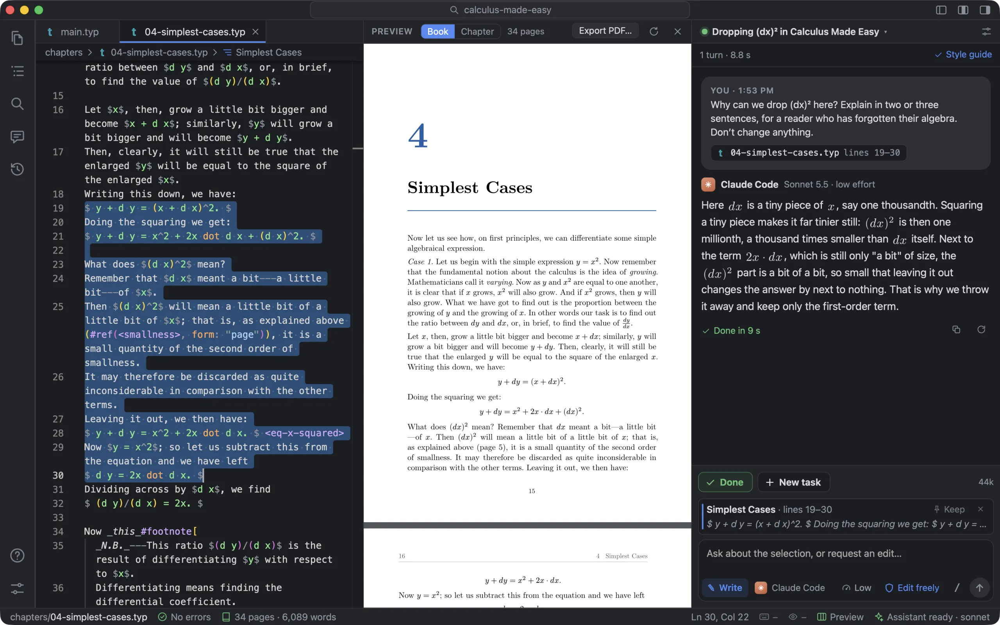
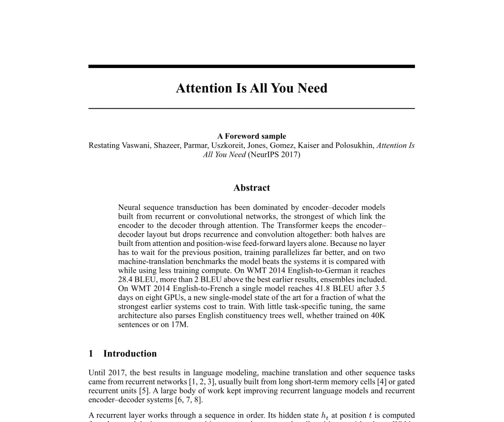
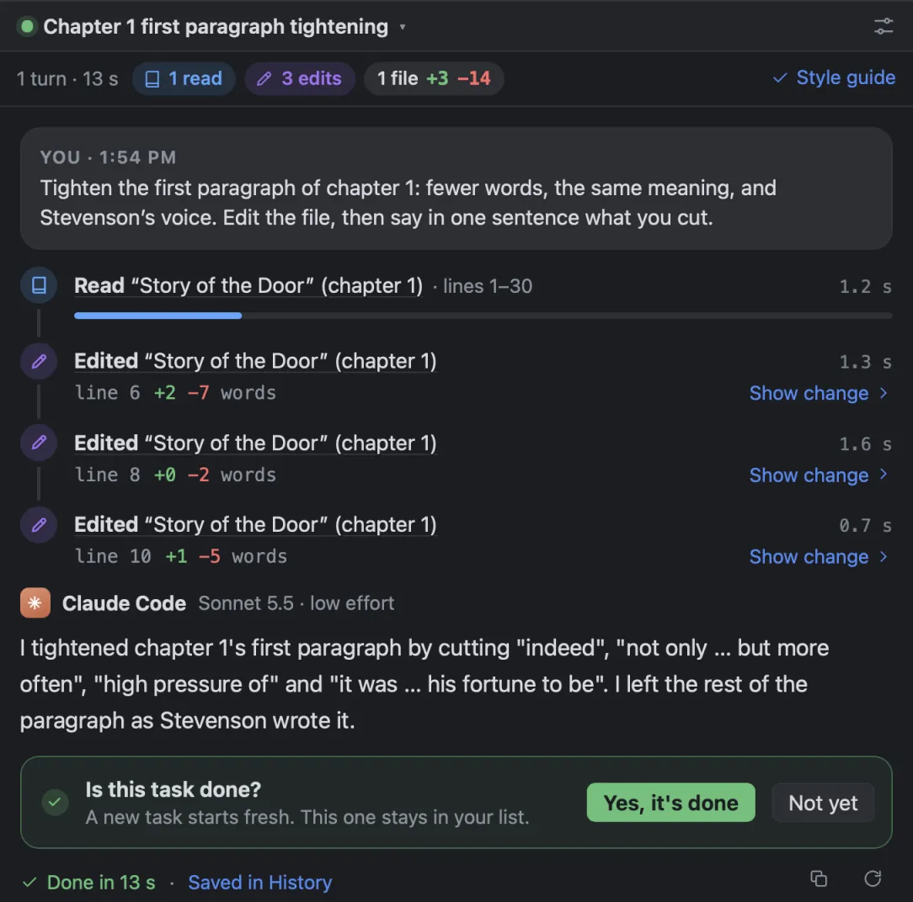
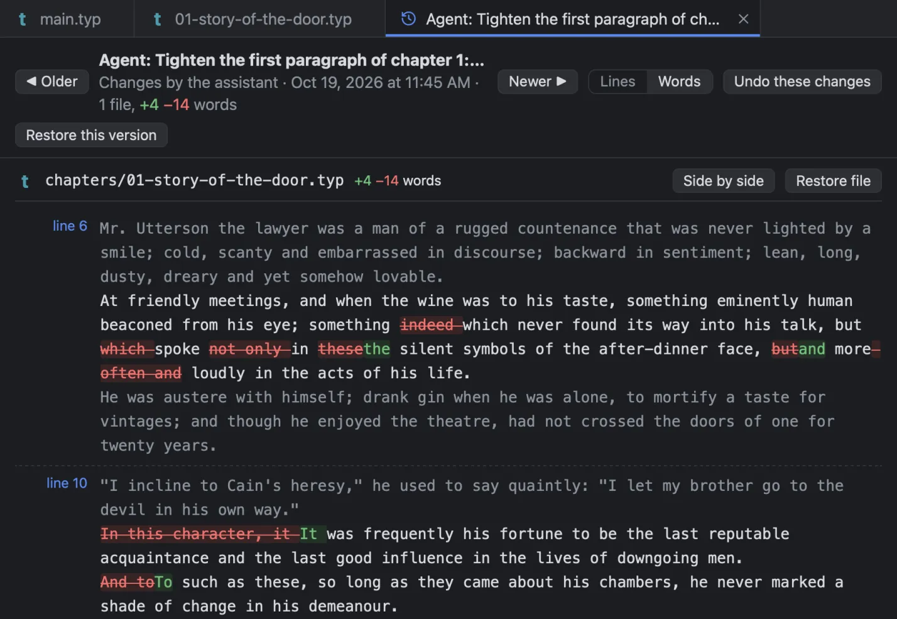

<div align="center">


# Typst Studio

**Write your book with AI. See every page as it'll print.**

A Mac app for writing books in [Typst](https://typst.app). Your chapter on one side, the finished pages on the other, updating as you type. Beside them, an AI assistant that drafts, revises and lays out the pages with you.


**[Download for Mac](https://github.com/jgeewax/typststudio/releases/latest/download/Typst-Studio_aarch64.dmg)** · [Website](https://jgeewax.github.io/typststudio/) · [Releases](https://github.com/jgeewax/typststudio/releases) · [What's new](CHANGELOG.md)

**New in 0.2:** export EPUB for any e-reader · a style guide by interview, or from a template · questions in a panel · effort beside the model · ask the assistant to change a setting

<br>



<sub><i>Calculus Made Easy, one of the sample books: a passage selected in the source, its pages in the preview, and the assistant explaining the step.</i></sub>

</div>

<br>

## Why another editor

Every tool for writing a book was made for something else.

| | |
| :-- | :-- |
| **Word** | Made for letters and reports. Three hundred pages in, the styles drift, the figures wander and the numbering breaks. |
| **Google Docs** | Made for sharing a draft, not for laying out pages you'd send to a printer. |
| **LaTeX** | Gorgeous pages, eventually. Slow builds, cryptic errors, and nothing to look at until it compiles. |
| **Typst** | Fast, readable and beautiful. But its editors are made for papers and programmers, not for writing a whole book. |
| **AI in a code editor** | The assistant is brilliant; the room is wrong. Terminals, diffs and build commands, when all you wanted was the next chapter. |

Typst Studio is made for one job: **writing a book**, with an AI assistant at your side and the pages in front of you.

## What it's like

<table>
<tr>
<td width="50%" valign="top">

### See the page as it'll print, while you type

A book lives or dies on details: a figure that lands two pages late, a reference that points nowhere, a citation that didn't resolve. Typst Studio typesets the book from what you've typed, saved or not, so you catch them the moment they happen, not after a slow build.

It redraws only the pages in view: in a 491-page book, a change shows up in about a tenth of a second. Click anything in the pages to jump to its source. A mistake is underlined where it is, in plain words, and the pages stay up while you fix it.

</td>
<td width="50%" valign="top">


<sub><i>Attention Is All You Need, set with the NeurIPS template.</i></sub>

</td>
</tr>
<tr>
<td width="50%" valign="top">


<sub><i>The assistant tightening the first paragraph of Jekyll and Hyde, and saying what it cut.</i></sub>

</td>
<td width="50%" valign="top">

### An AI assistant, in an editor made for writing

AI is a great writing partner, but a code editor is the wrong place to write a book. Here the assistant works on chapters and passages. Select some text, ask about it or ask for a change, and it edits the book itself, then tells you what it did in a sentence or two. Its steps read as sentences, like *Read "Story of the Door" (chapter 1)*, never as shell commands.

It reads the chapters it needs and follows your book's style guide, and the lines it changed stay marked, so you know what's yours. **Plan** talks a chapter through before anything is written. **Options** gives you three versions of a passage to pick from. When it needs you to decide something, it asks in a panel where you type, with answers to pick from. You decide what it may do without asking.

</td>
</tr>
<tr>
<td width="50%" valign="top">

### Beautiful layouts, without learning how

Typst can set almost anything a book designer can imagine, if you know how to ask it. Now you don't have to. Say what you want in plain words, the assistant writes the Typst, and the result is on the page a moment later:

> *“Start every chapter on a right-hand page.”*<br>
> *“Put this paragraph in a shaded box beside the text.”*<br>
> *“Draw a flowchart of the hiring process.”*<br>
> *“Make a chart from data/sales.csv.”*

And when you're stuck, it gets you moving: an outline for the next chapter, a rough first pass, three ways to open a scene.

</td>
<td width="50%" valign="top">


<sub><i>Luca's Wonderful Brain, a picture book: words and sound words set on full-page watercolours.</i></sub>

</td>
</tr>
<tr>
<td width="50%" valign="top">

### Comment through the chapter, then fix it all at once

Chat is good for one change at a time. Revising a chapter is dozens. So read it through like an editor and leave a comment wherever something's off: *too slow*, *cut this*, *needs a source*. Then press **Fix all**. The assistant works through every comment, and you check each change before it stays.

Comments sit beside the text, never in it.

</td>
<td width="50%" valign="top">

1. **Plan the chapter.** Talk it through with the assistant first. Nothing changes until you're ready.
2. **Comment as you read.** Select a passage, in the text or the pages, and press <kbd>⌥</kbd><kbd>⌘</kbd><kbd>M</kbd>.
3. **Fix them all.** One click, *Fix all with the assistant*, hands every open comment over.
4. **Check each change.** See it before and after, then **Keep** it or **Undo change**.

</td>
</tr>
<tr>
<td width="50%" valign="top">


<sub><i>What the assistant changed in chapter one, with Undo these changes.</i></sub>

</td>
<td width="50%" valign="top">

### Go back to any version. No Git required

Engineers keep every version in Git. Most writers keep *chapter-3-final-v2-REAL.docx*. Typst Studio keeps the versions for you, as you work and around every change the assistant makes, in a repository of its own outside the book's folder.

Open any version to see what changed, line by line or word by word, then undo just that change or put the whole book back. Name a version, like “Draft sent to my editor”. Already keep your book in Git? Source Control stages, commits, pulls and pushes it.

</td>
</tr>
</table>

## Bring the AI you already use

The assistant is a program on your Mac, signed in with your own account, so there's no new subscription. Pick one in **Settings ▸ Assistant**, or from the chat, beside the model.

| Assistant | From | Runs on | How Typst Studio talks to it |
| :-- | :-- | :-- | :-- |
| **OpenCode** | Open source | Any model you've set up in it: OpenAI, Anthropic, Google, or one on your Mac | Its own server |
| **Claude Code** | Anthropic | Your Claude plan or an API key | Agent Client Protocol |
| **Codex** | OpenAI | Your ChatGPT plan or an API key | Agent Client Protocol |
| **Antigravity** | Google | Your Google account, a Gemini API key or Gemini Enterprise | Agent Client Protocol, through Google's connector (Settings downloads it) |
| **Gemini CLI** | Google | A paid Gemini API key or a Gemini Code Assist work account | Agent Client Protocol |

Each conversation is its own task, and several can run at once. Choose the model, and how hard it thinks (Claude Code's effort, Codex's reasoning effort, an OpenCode model's variants), beside the message box. Or just ask: *"switch me to Claude Code with its default model"*, *"make the text bigger"*, and the assistant changes Typst Studio's settings itself, asking you first if you'd like it to (it can never change its own permissions). Settings ▸ Assistant says what each one needs on your Mac and signs you in.

## Everything else a book needs

- **Templates for any book.** A novel, non-fiction, a textbook, a programming book or a picture book, at the page sizes printers use in the US, the UK and Europe, and Asia. Papers start from IEEE, ACM, NeurIPS, CVPR, AAAI, ACL, Springer LNCS, arXiv, AMS or APA.
- **Sample books to try.** Open a finished one and try the assistant on it: *Jekyll and Hyde*, *Calculus Made Easy*, *The Elements of Style*, *Luca's Wonderful Brain*, *Attention Is All You Need*, and *Counting Words*, whose Python examples run.
- **Code that runs.** Examples in Python, JavaScript, R, Julia, Ruby, Lua, Perl and shell run from the book, with their real output set beneath and checked against what you expect.
- **Covers and printing.** Design a print cover with the spine worked out from the page count, check the files against the printer's rules, and order through Mixam.
- **E-books.** Export an EPUB for Apple Books, Kobo, Google Play and Kindle: reflowing text for prose, or every page exactly as typeset for picture books, papers and books full of math. Typst Studio picks for you and says what didn't carry over.
- **Your style, kept.** A `WRITING_STYLE.md` for each book (voice, tone, terminology) that every request follows. Start it from a template for your kind of book, let the assistant draft it from your chapters, or answer its questions and have it write the guide from your answers. Redraft it whenever it isn't quite right: it keeps the rules you wrote, and learns from how you've rewritten its text.
- **New to Typst?** Typst is plain text with a little markup. *Typst basics* opens beside your book and takes about five minutes; the assistant answers the rest.
- **Familiar keys.** A command palette (<kbd>⇧</kbd><kbd>⌘</kbd><kbd>P</kbd>), Go to File (<kbd>⌘</kbd><kbd>P</kbd>), tabs and shortcuts as in VS Code, formatting on save, wrapping at a column with rulers, and a window for each book.

## Download

**[Download Typst Studio for Mac](https://github.com/jgeewax/typststudio/releases/latest/download/Typst-Studio_aarch64.dmg)** (Apple Silicon, macOS 13 or later), or pick a version from the [releases](https://github.com/jgeewax/typststudio/releases). Open it and drag Typst Studio to Applications. It carries Tinymist and OpenCode, so it needs nothing else installed. To build one from any branch, run **Actions ▸ Release build ▸ Run workflow**; the DMG is kept with the run.

The app isn't notarized yet, so the first time macOS may ask: open System Settings ▸ Privacy & Security and click **Open Anyway**. A copy fetched with `gh release download` opens without asking.

After that it keeps itself up to date. When a new version is out, Typst Studio offers it as it starts: install it now (it downloads, installs and starts again), when you quit, or skip that version. **Settings ▸ General ▸ Updates** and **Typst Studio ▸ Check for Updates…** check any time. Every update is checked against its signature before it's installed.

## Run it from source

It runs on macOS (Apple Silicon first) and needs Xcode's command line tools, Rust, Node.js and [Tinymist](https://github.com/Myriad-Dreamin/tinymist), which typesets the preview.

```sh
# the tools (and xcode-select --install, if you haven't)
brew install rust node tinymist

# the app
git clone https://github.com/jgeewax/typststudio.git
cd typststudio
npm install
npm run app
```

Then choose **New Book**, or open one of the samples. For the assistant, install one of OpenCode, Claude Code, Codex or Gemini CLI and sign in once (`brew install opencode` is the quickest), or pick Antigravity, which Settings downloads for you.

## Working on it

| | |
| :-- | :-- |
| [`src/`](src) | The app: React and TypeScript, with Monaco as the editor. `app/studio.ts` holds the state; `services/agent/` speaks to the assistants. |
| [`src-tauri/`](src-tauri) | The Mac side, in Rust: the window, files, Tinymist (`lsp.rs`), History (`history.rs`), Git, the assistants (`agent.rs`, `acp.rs`), printing. |
| [`src/templates/`](src/templates), [`samples/`](samples) | The book templates, and the sample books New Book offers. |
| [`fixtures/sample-book/`](fixtures/sample-book) | The book the self-tests open. |
| [`docs/decisions.md`](docs/decisions.md) | Decisions and what they were measured against. |
| [`SPEC.md`](SPEC.md), [`IDEAS.md`](IDEAS.md), [`TODO.md`](TODO.md) | What it's meant to be, what it might become, and what's next. |
| [`CHANGELOG.md`](CHANGELOG.md) | What's new in each version. |

```sh
npm run app             # run it, reloading as you edit (tauri dev)
npm test                # unit tests (Vitest)
npm run typecheck       # TypeScript
npm run check-templates # every template still compiles
npm run app:build       # the app and its DMG, with OpenCode and Tinymist inside
(cd src-tauri && cargo test)
```

To release a version, write its section in `CHANGELOG.md` (`## 0.3.0 · <date>`), then `npm run release -- 0.3.0`: it sets the version, tags it and pushes the tag, and the release build publishes the DMG and the update that every installed copy is offered, with that section as its notes (the app shows them under What's new). Updates are signed with the key in the `TAURI_SIGNING_PRIVATE_KEY` secret; keep its copy safe, since installed copies accept updates signed with that key only.

The self-tests drive the real app, in a second window beside yours (once `npm run app` has built it). Point one at a scratch copy of a book, name the groups to run (see `src/selftest.ts`), and it writes its results and screenshots next to `out.json`:

```sh
cp -R fixtures/sample-book /tmp/book && mkdir -p /tmp/st
cd src-tauri && TYPST_STUDIO_WORKSPACE=/tmp/book TYPST_STUDIO_SELFTEST=/tmp/st/out.json \
  TYPST_STUDIO_SELFTEST_ONLY=settings target/debug/typst-studio
```

<br>

<div align="center">
<sub>Made by JJ Geewax in Singapore. Typst Studio is an independent project: it isn't made by, or affiliated with, the Typst team.</sub>
</div>
