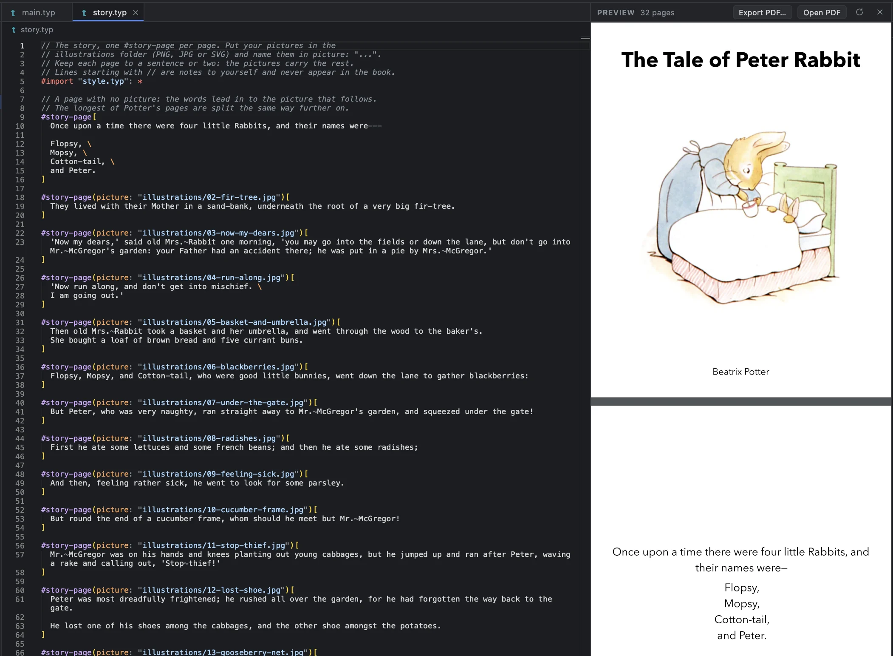

<div align="center">

# Typst Studio

**Write books in plain text. Watch them become books.**

A Mac app for writing books, papers and picture books in [Typst](https://typst.app). The typeset pages update beside your words as you type, and a writing assistant reads, explains and edits with you, showing every change it makes.


<br>


<sub><i>Calculus Made Easy, one of the sample books: a passage selected in the source, its pages in the preview, and the assistant explaining the step.</i></sub>

</div>

<br>

## What it's like

<table>
<tr>
<td width="50%" valign="top">

### The pages as they'll print, while you type

Typst Studio typesets the book from what you've typed, saved or not, and redraws only the pages in view. In a 491-page book, a change reaches the preview in about a tenth of a second.

Click a passage in the preview to go to its source. An error is underlined where it is, and the preview keeps the last good pages until it's fixed.

</td>
<td width="50%" valign="top">


<sub><i>Attention Is All You Need, set with the NeurIPS template.</i></sub>

</td>
</tr>
<tr>
<td width="50%" valign="top">


<sub><i>The assistant tightening the first paragraph of Jekyll and Hyde.</i></sub>

</td>
<td width="50%" valign="top">

### An assistant that edits, and shows its work

Select a passage and ask about it, or ask for a change. The assistant reads the chapters it needs, follows your book's style guide, and edits the files themselves. Its steps read as sentences, like *Read "Story of the Door" (chapter 1)*, never as shell commands.

**Plan** talks a change through before writing it. **Options** gives three versions of a passage to pick from. You decide what it may do without asking.

</td>
</tr>
<tr>
<td width="50%" valign="top">

### Every version, and what changed in it

History saves a version as you work and around every assistant change, in a repository of its own, outside the book's folder. Open any version to see what changed, line by line or word by word, then undo just that change or put the whole book back.

Already keep your book in Git? Source Control stages, commits, pulls and pushes it.

</td>
<td width="50%" valign="top">


<sub><i>What changed in the assistant's version, with Undo these changes.</i></sub>

</td>
</tr>
<tr>
<td width="50%" valign="top">


<sub><i>The Tale of Peter Rabbit, as a picture book: one page per picture.</i></sub>

</td>
<td width="50%" valign="top">

### Novels, textbooks, picture books and papers

Start from a template: a novel, non-fiction, a textbook, a programming book or a picture book, at the page sizes printers use in the US, the UK and Europe, and Asia. Papers start from IEEE, ACM, NeurIPS, CVPR, AAAI, ACL, Springer LNCS, arXiv, AMS or APA.

Or open a finished sample and try the assistant on it: *Jekyll and Hyde*, *Calculus Made Easy*, *The Elements of Style*, *The Tale of Peter Rabbit*, *Attention Is All You Need*, and *Counting Words*, whose Python examples run.

</td>
</tr>
</table>

## Bring the assistant you already use

The writing assistant is a program on your Mac, signed in with your own account. Pick one in **Settings ▸ Assistant**, or from the chat, beside the model.

| Assistant | From | Runs on | How Typst Studio talks to it |
| :-- | :-- | :-- | :-- |
| **OpenCode** | Open source | Any model you've set up in it: OpenAI, Anthropic, Google, or one on your Mac | Its own server |
| **Claude Code** | Anthropic | Your Claude plan or an API key | Agent Client Protocol |
| **Codex** | OpenAI | Your ChatGPT plan or an API key | Agent Client Protocol |
| **Antigravity** | Google | Your Google account, a Gemini API key or Gemini Enterprise | Agent Client Protocol, through Google's connector (Settings downloads it) |
| **Gemini CLI** | Google | A paid Gemini API key or a Gemini Code Assist work account | Agent Client Protocol |

Each conversation is its own task, and several can run at once. Settings ▸ Assistant says what each one needs on your Mac and signs you in.

## Made for the whole job of a book

- **Review comments.** Comment on passages as an editor would, then have the assistant address them, each change kept or undone on its own.
- **Code that runs.** Examples in Python, JavaScript, R, Julia, Ruby, Lua, Perl and shell run from the book, with their real output set beneath and checked against what you expect.
- **Covers and printing.** Design a print cover with the spine worked out from the page count, check the files against the printer's rules, and order through Mixam.
- **Your style, kept.** A `WRITING_STYLE.md` for each book (voice, tone, terminology) that every request follows. The assistant can draft it from your chapters.
- **New to Typst?** Typst is plain text with a little markup. *Typst basics* opens beside your book and takes about five minutes; the assistant answers the rest.
- **Familiar keys.** A command palette (<kbd>⇧</kbd><kbd>⌘</kbd><kbd>P</kbd>), Go to File (<kbd>⌘</kbd><kbd>P</kbd>), tabs and shortcuts as in VS Code, formatting on save, and a window for each book.

## Download

Each version tag (`v0.1.0`) builds a DMG for Macs with Apple Silicon and attaches it to a [release](https://github.com/jgeewax/typststudio/releases). Open it and drag Typst Studio to Applications. It carries Tinymist and OpenCode, so it needs nothing else installed. To build one from any branch, run **Actions ▸ Release build ▸ Run workflow**; the DMG is kept with the run.

The app isn't notarized yet, so the first time macOS may ask: open System Settings ▸ Privacy & Security and click **Open Anyway**. A copy fetched with `gh release download` opens without asking.

## Run it from source

It runs on macOS (Apple Silicon first) and needs Xcode's command line tools, Rust, Node.js and [Tinymist](https://github.com/Myriad-Dreamin/tinymist), which typesets the preview.

```sh
# the tools (and xcode-select --install, if you haven't)
brew install rust node tinymist

# the app
git clone https://github.com/jgeewax/typststudio.git
cd typststudio
npm install
npm run app
```

Then choose **New Book**, or open one of the samples. For the assistant, install one of OpenCode, Claude Code, Codex or Gemini CLI and sign in once (`brew install opencode` is the quickest), or pick Antigravity, which Settings downloads for you.

## Working on it

| | |
| :-- | :-- |
| [`src/`](src) | The app: React and TypeScript, with Monaco as the editor. `app/studio.ts` holds the state; `services/agent/` speaks to the assistants. |
| [`src-tauri/`](src-tauri) | The Mac side, in Rust: the window, files, Tinymist (`lsp.rs`), History (`history.rs`), Git, the assistants (`agent.rs`, `acp.rs`), printing. |
| [`src/templates/`](src/templates), [`samples/`](samples) | The book templates, and the sample books New Book offers. |
| [`fixtures/sample-book/`](fixtures/sample-book) | The book the self-tests open. |
| [`docs/decisions.md`](docs/decisions.md) | Decisions and what they were measured against. |
| [`SPEC.md`](SPEC.md), [`IDEAS.md`](IDEAS.md), [`TODO.md`](TODO.md) | What it's meant to be, what it might become, and what's next. |

```sh
npm run app             # run it, reloading as you edit (tauri dev)
npm test                # unit tests (Vitest)
npm run typecheck       # TypeScript
npm run check-templates # every template still compiles
npm run app:build       # the app and its DMG, with OpenCode and Tinymist inside
(cd src-tauri && cargo test)
```

The self-tests drive the real app, in a second window beside yours (once `npm run app` has built it). Point one at a scratch copy of a book, name the groups to run (see `src/selftest.ts`), and it writes its results and screenshots next to `out.json`:

```sh
cp -R fixtures/sample-book /tmp/book && mkdir -p /tmp/st
cd src-tauri && TYPST_STUDIO_WORKSPACE=/tmp/book TYPST_STUDIO_SELFTEST=/tmp/st/out.json \
  TYPST_STUDIO_SELFTEST_ONLY=settings target/debug/typst-studio
```

<br>

<div align="center">
<sub>Typst Studio is an independent project. It isn't made by, or affiliated with, the Typst team.</sub>
</div>
